# Estilos de arte

NO ONE LIKE CATS es un **multiverso de estilos**: como en *Into the Spider-Verse*, cada elemento, pantalla y momento vive en su propia "dimensión de estilo", y el choque entre estilos es la identidad del juego. Lo que lo une todo es una gramática compartida (papel, tinta, bloques de color planos, tipografía enorme) y una regla: **todo es vector o se dibuja en código, nunca raster.**

Esta página es la galería: qué estilos hay, dónde se usa cada uno, sus reglas de color y línea, qué sí y qué no, y en qué documento está la biblia completa.

Volver a: [README](../../README.md) · [índice](../INDICE.md) · [CONTRIBUTING](../../CONTRIBUTING.md) · [agregar un gato](../guias/agregar-gato.md)

> Las miniaturas son los **SVG ligeros del juego** (`game/public/cats-svg/lite/`), sin copias ni capturas. Cada uno pesa entre 0,7 y 1,2 MB, así que esta página carga unos 10 MB: dale unos segundos.

## Contenido

1. [Reglas que valen para todo](#1-reglas-que-valen-para-todo)
2. [La gramática común (Parte I)](#2-la-gramática-común-parte-i)
3. [Los gatos pintados: el estilo de siempre](#3-los-gatos-pintados-el-estilo-de-siempre)
4. [Las rarezas](#4-las-rarezas)
5. [Los elementos y sus dimensiones](#5-los-elementos-y-sus-dimensiones)
6. [Parte II: el diorama de juguete](#6-parte-ii-el-diorama-de-juguete)
7. [Los Momentos musicales: un estilo por canción](#7-los-momentos-musicales-un-estilo-por-canción)
8. [Parte III: las dimensiones](#8-parte-iii-las-dimensiones)
9. [El pipeline: de la pintura al gato vivo](#9-el-pipeline-de-la-pintura-al-gato-vivo)
10. [Cómo ver los estilos en vivo](#10-cómo-ver-los-estilos-en-vivo)

---

## 1. Reglas que valen para todo

- **Cero raster en el repo.** Ni PNG, ni JPG, ni WebP, ni GIF. Las pinturas fuente viven fuera del repo; al juego solo entra el SVG que sale de [MAI SVG](https://github.com/Ragosorio/MAI-SVG). El deploy falla si se cuela un raster.
- **El gato se lee como gato** en cualquier estilo: anatomía de gato real con proporciones un poco chibi.
- **Encuadre fijo** para que el rig funcione: gato completo, vista 3/4 mirando un poco a la izquierda, patas en la línea de abajo, nada cortado, fondo transparente.
- **Los dos ojos abiertos y visibles** (así parpadea), orejas libres, **la cola visible y lejos de la cara**, objetos flotantes con aire alrededor.
- **La textura de pantalla va en código, nunca en la pintura.** Trama, Ben-Day, grano de película, acuarela o brillantina se ponen con shaders y filtros; la pintura se queda limpia.
- **Un gato nunca se deforma más allá de su rig**: la cabeza no se estira y los ojos no se desplazan.
- **Nada de emojis** en pantalla: los elementos tienen insignias SVG.
- **Destellos con cuidado**: nunca un rojo saturado a pantalla completa, y con «Reducir destellos» todo destello es suave.

---

## 2. La gramática común (Parte I)

Es lo que nunca cambia, venga de donde venga una pantalla.

| Pieza | Regla |
|---|---|
| Soporte | Papel crema con grano (`#EAE1D3` / `#EDE4D6`). Toda la interfaz "está impresa". |
| Tinta | Negro tinta `#171317` y azul tinta editorial `#1F2B4A`. |
| Titulares | Sans condensada gigante (Anton, Bebas Neue), en mayúsculas, a veces cortada por el borde. |
| Formas | Círculo grande de acento (rosa `#E8879A`, rojo `#C8102E`), bloques sólidos superpuestos, retícula de puntos, cruces finas. |
| Textura | Halftone en sombras, misregistro de 1–3 px en los impactos, papel rasgado en las transiciones. |
| Movimiento | Personajes "en dos" (12 fps escalonado); cámara, interfaz y partículas a 60 fps. |
| Tipografías | Anton y Bebas Neue (titulares), Bangers y Dela Gothic One (onomatopeyas y daño), Permanent Marker (a mano), UnifrakturMaguntia (cabecera del periódico), Playfair Display (elegante), Rubik Glitch (glitch) y Space Grotesk (interfaz). |

**Regla de choque.** Cuando dos dimensiones se tocan, se nota la costura: cada una conserva su estilo y su ritmo. El gato que ataca "trae" su dimensión a la pantalla durante su turno.

| Sí | No |
|---|---|
| Interfaz "impresa": papel, tinta y titulares enormes | Botones genéricos con degradados y sombras de app |
| Los colores de `C` y las fuentes de `F` (`game/src/ui/theme.ts`) | Colores o fuentes sueltos en el código |
| Insignias SVG para los elementos | Emojis |

Biblia completa: [research/10-direccion-de-arte.md](../../research/10-direccion-de-arte.md). Paleta y fuentes en código: `game/src/ui/theme.ts` (`C`, `F`).

---

## 3. Los gatos pintados: el estilo de siempre

| 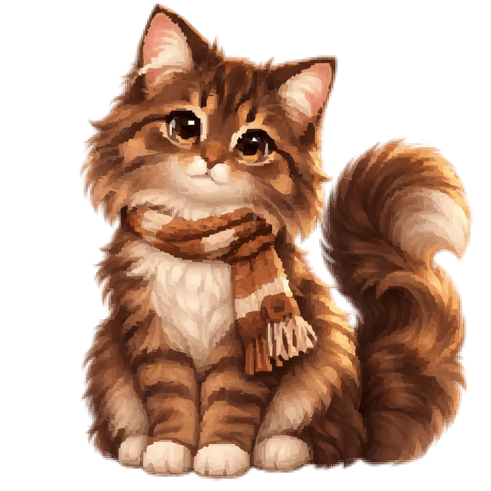 | 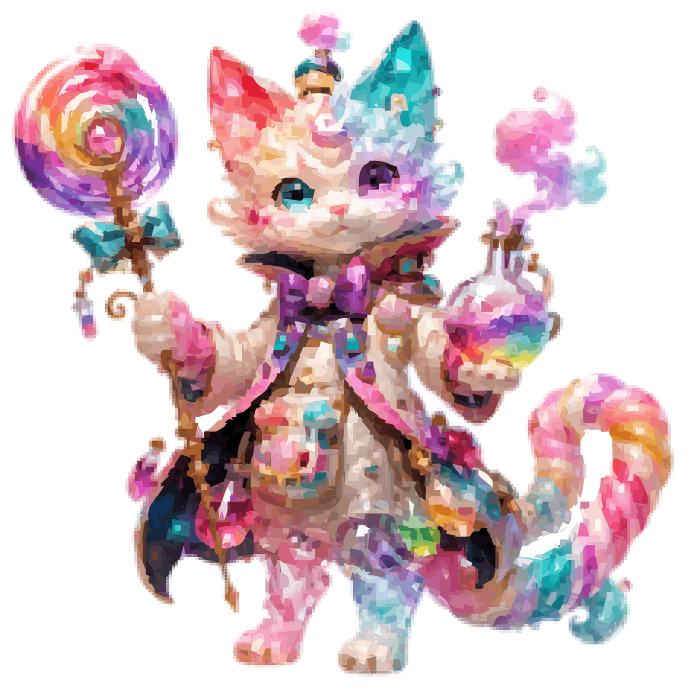 | 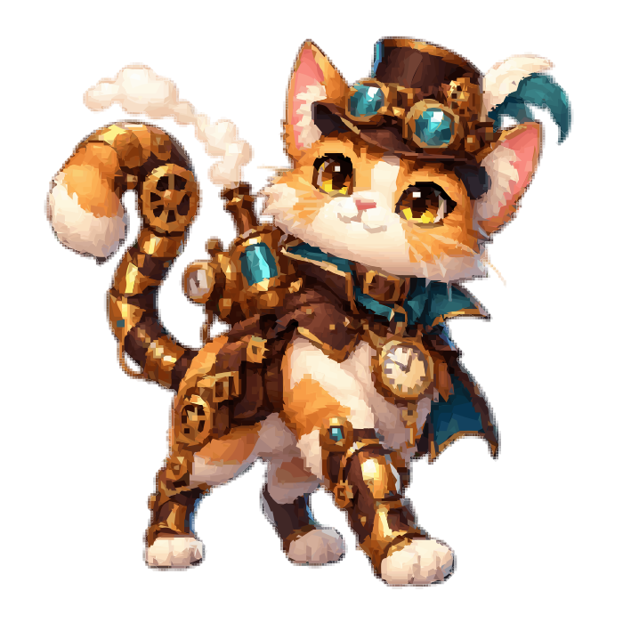 |
|:---:|:---:|:---:|
| **Canelo**, el Impaciente | **Caramelo Alquimista** | **Imán** |
| `canelo_cozy_cat` | `candy_alchemist_cat` | `steampunk_clockwork_cat` |

Estos tres son las referencias de estilo para pintar un gato nuevo.

- **Dónde se usa:** en todas partes donde aparece un gato: la isla, la batalla, la Catdex, las revelaciones, los retratos de historia y, en la Parte II, las islas 3D (la misma pintura como cartón con su malla). La **Battle Form** es el mismo gato: la transformación se arma en código (viñeta de los ojos, líneas de velocidad, el nombre de la forma y su grito), nunca con otra pintura.
- **Color y línea:** ilustración de colección estilo anime pintado. Ojos grandes y brillantes con reflejos nítidos, pelo suave con detalle, sombreado cel limpio de bordes nítidos, colores saturados, vestuario y accesorios temáticos con mucho detalle. El contorno sale de la propia pintura.
- **Formato:** 700×700 lógicos, gato al ~85 % del alto, dos SVG del mismo dibujo (completo y ligero).

| Sí | No |
|---|---|
| Un accesorio protagonista que cuente quién es (una bengala, una tetera, un telescopio) | Fondos, piso, sombra proyectada, marcos |
| Pose de 3/4 hacia la izquierda; el juego lo voltea cuando hace falta | Texto, firmas o letras en la ropa |
| Cola que sale hacia un lado | Cola tapando la cara, ojos cerrados o tapados por pelo o sombrero |
| Flotantes separados del cuerpo | Desenfoque de movimiento o brillos que tapen la silueta |
| Un pelaje con color y patrón propios, escritos en la ficha | Otro gato atigrado café genérico |

Biblia: [DIRECCION-ARTE-PARTE-2.md §1](DIRECCION-ARTE-PARTE-2.md) (entrega, estilo base y las fichas de cada gato).

---

## 4. Las rarezas

La rareza se ve en el **marco** que pone el juego (colores en `RARITY`, `game/src/ui/theme.ts`) y en **lo que pide el dibujo**.

| | Rareza | Marco (color / brillo) | Qué pide el dibujo |
|:---:|---|---|---|
|  | **Común** · Canelo | papel · `#9A8F80` / `#D9CDB8` | Simple, tierno, un solo accesorio protagonista. |
|  | **Raro** · Imán | tinta azul · `#3569A3` / `#6FA8FF` | Dos ideas combinadas, más detalle. |
| 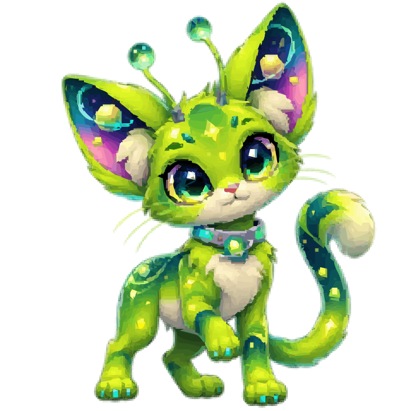 | **Épico** · Nebulosa | rosa neón · `#FF2E88` / `#FF7AB8` | Pose con actitud, efectos del elemento alrededor. |
| 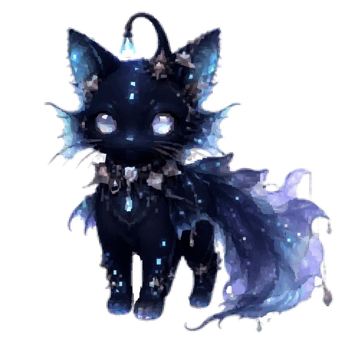 | **Legendario** · Abisa (primordial del Agua) | dorado y foil · `#B89558` / `#FFD77A` | Majestuoso, silueta grande, accesorio legendario. |
| 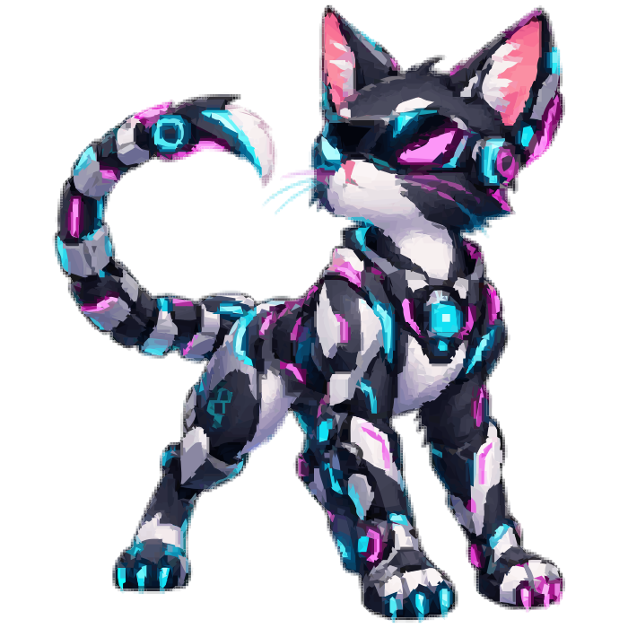 | **Mítico** · Raijin | holográfico · `#8A5CFF` / `#00E5FF` | Casi un dios; materiales imposibles. |
| 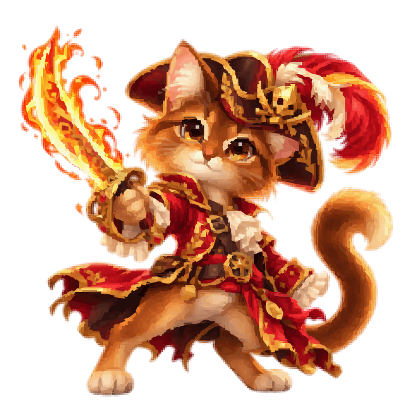 | **Heroico** · Capitana Zarpa | carmesí y laureles · `#B3122E` / `#FFC94A` | Guerreros del Podio: pose de pelea, arma o insignia de campeón. |
| 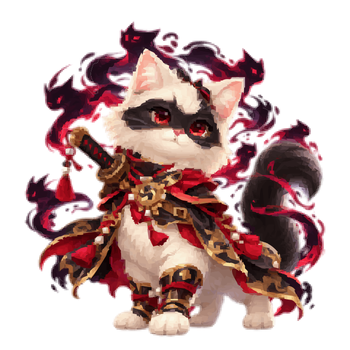 | **Divino** · Mil Vidas | nácar y halo · `#2F9A96` / `#FFF3E6` | Los "rotos": el fin del mundo en forma de gato. |

**Primordial** no es una rareza aparte: es el legendario que funda un elemento (hay 17). Su marco es negro tinta con brillo rosa (`#171317` / `#FF2E88`), "con ruido de otra dimensión".

| Sí | No |
|---|---|
| Que la rareza se lea en la pintura misma: más ideas, más actitud y materiales más imposibles conforme sube | Confiar solo en el marco: un legendario que parece común con borde dorado |
| Heroicos con pose de pelea y su arma o insignia de campeón | Un Divino tierno y tranquilo: los Divinos se ven como el fin del mundo |
| Un común simple y tierno, con un solo accesorio protagonista | Llenar un común de efectos que le roban el lugar a un épico |

Biblia: [DIRECCION-ARTE-PARTE-2.md §1](DIRECCION-ARTE-PARTE-2.md) (tabla de rarezas) y §5 (Heroicos y Divinos).

---

## 5. Los elementos y sus dimensiones

Cada elemento trae su propia **dimensión de estilo** de impresión. Se ve en el Altar, en los pósters, en la secuencia de descubrimiento ("el mundo se reimprime con tu color") y en los efectos de sus gatos. Las insignias son SVG de `game/public/icons/el-<id>.svg`; la paleta es la del contenido (oscuro, claro, principal, acento).

| | Elemento | Dimensión de estilo | Paleta |
|:---:|---|---|---|
|  | Fuego | ANIME INFERNO | `#4E0000` `#C8102E` `#FF6A1A` `#FFC94A` |
| 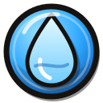 | Agua | NOIR OCEÁNICO + ukiyo-e | `#172B35` `#204A7A` `#3569A3` `#A7E8D7` |
|  | Naturaleza | ACUARELA + sakura | `#C6F0E4` `#64165D` `#E8879A` `#5FBF4A` |
| 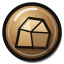 | Tierra | DIARIO DEL MAR (grabado, xilografía) | `#1F2B4A` `#EAE1D3` `#A8743F` `#E0B77A` |
| 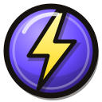 | Tormenta | CÓMIC SILVER AGE (Kirby krackle) | `#0D110F` `#FFD400` `#00E5FF` `#FFFFFF` |
| 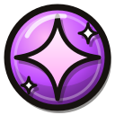 | Magia | ORQUÍDEA REAL (tarot, art nouveau, foil) | `#231626` `#5C3D5B` `#8F6B93` `#B89558` |
| 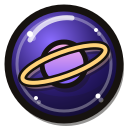 | Cósmico | NEÓN GLITCH (datamosh) | `#0D110F` `#FF2E88` `#00E5FF` `#8A5CFF` |
| 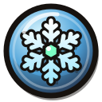 | Hielo | AURORA (ukiyo-e glacial + aurora boreal) | `#1F2B4A` `#EAF6FF` `#4FA3D9` `#7CFFC4` |
| 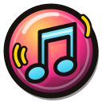 | Sonido | PÓSTER DE CONCIERTO (risografía, city-pop) | `#231626` `#FFD400` `#FF2E88` `#2EC4E6` |
| 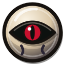 | Sombra | TEATRO DE SOMBRAS (kage-e, tinta, acento rojo) | `#0D110F` `#EAE1D3` `#2A2433` `#C8102E` |
| 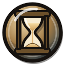 | Tiempo | DAGUERROTIPO (sepia, reloj de arena, astrolabio) | `#1C3A51` `#D9C29A` `#6B4F2A` `#E0B77A` |
|  | Luz | VITRAL (vidrio de catedral + art déco dorado) | `#B89558` `#FFF8E1` `#FFD77A` `#E8879A` |
| 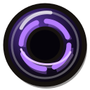 | Vacío | NOIR INVERTIDO + estática de TV | `#0D110F` `#FFFFFF` `#231626` `#FF2E88` |
| 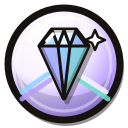 | Cristal (Parte II) | NÁCAR PRISMÁTICO (madreperla + vidrio de mar) | `#B79CFF` `#F7F2FF` `#8FD3FF` `#6FE0C8` |
|  | Gravedad (Parte II) | CIANOTIPO ORBITAL (planos de observatorio + plomadas de latón) | `#13224A` `#E9F0FF` `#3E6FD8` `#F0B44C` |

| Sí | No |
|---|---|
| Una dimensión que todavía no exista para un elemento nuevo | Repetir el estilo de otro elemento (Tiempo **no** es steampunk: eso ya es Imán) |
| Insignia de 128×128 con círculo, símbolo al centro y contorno de tinta (usa `el-fire.svg` de plantilla) | Usar un emoji como insignia |

Dónde vive en código: `game/src/panels/collection/dimension.ts` (`D`), `ELEMENT_FX` en `game/src/art/catArt.ts` y `game/src/fx/sequences/elementDiscovery.ts`. Biblia: [research/10-direccion-de-arte.md §2](../../research/10-direccion-de-arte.md), [DIRECCION-ARTE-PARTE-2.md §2](DIRECCION-ARTE-PARTE-2.md) y la guía [agregar-elemento.md](../guias/agregar-elemento.md).

---

## 6. Parte II: el diorama de juguete

| 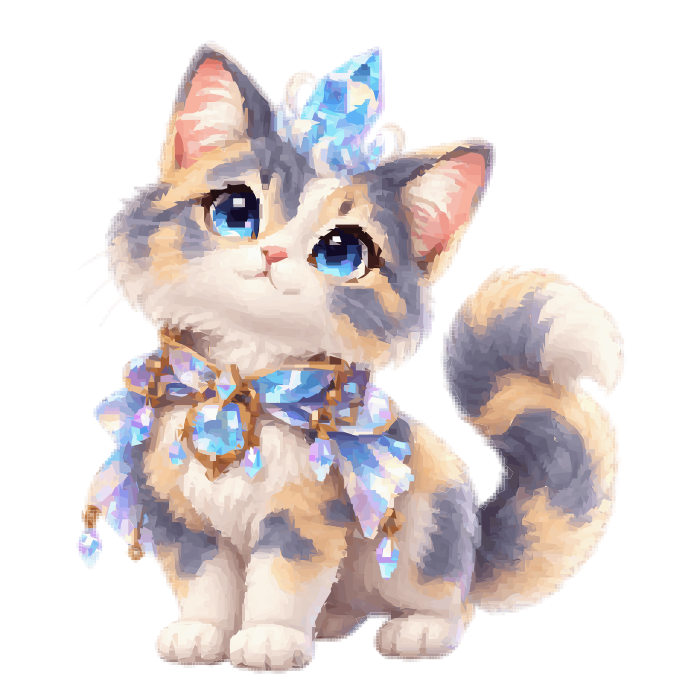 | 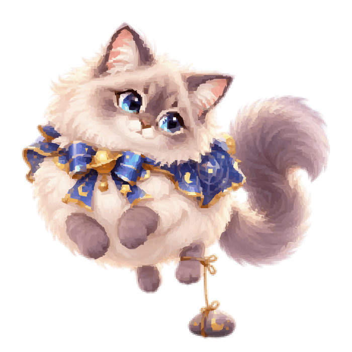 | 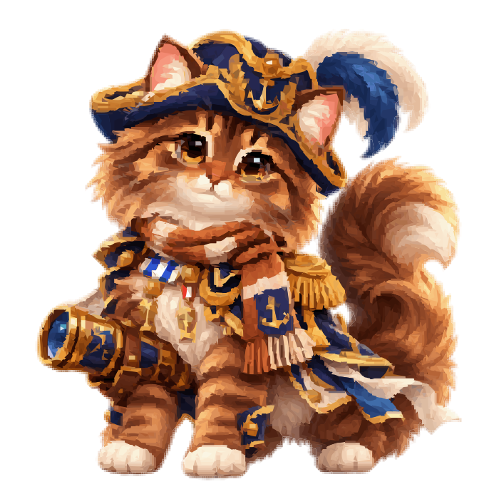 |
|:---:|:---:|:---:|
| **Brillito** (Cristal) | **Globito** (Gravedad) | **Canelo Almirante** (una forma de Canelo) |

**Identidad en una frase: gatos pintados viviendo en un diorama de juguete iluminado a mano.** Lo pintado manda: el mundo tiene formas simples y legibles para que los gatos sean lo más detallado de la pantalla.

- **Dónde se usa:** las islas 3D de la Parte II (three.js), la isla de noche, las cines y la vista "Página".
- **Jerarquía de detalle:** gatos (máximo) → personajes y props de historia (alto) → hábitats (medio, mucha animación) → terreno, agua y vegetación (poca forma, mucha luz y movimiento) → lejanía (mínimo).
- **Formas:** volúmenes gordos y redondeados, rocas y cristales facetados, edificios "de juguete" achatados con techos grandes.
- **Luz por hora:** amanecer en melocotón y lavanda, día en cobalto y turquesa, hora dorada en ámbar, anochecer en malva y violeta, y noche en **azul profundo, nunca negro** (los gatos se tienen que ver). El sombreado pintado del gato domina (~70 %); la luz del mundo solo lo asienta.
- **Lentes por región:** cada isla aplica una lente (postproceso o material) sobre el mismo motor: grano de papel y niebla sepia, refracción y cáusticas, ilustración luminosa, cielo abajo y mar arriba, retrofuturo con scanlines, acuarela pastel, desaturación donde solo tus gatos conservan el color…
- **La Página:** la isla de la Parte I vista como carta: papel, mar en dos azules (`#4B93C4` / `#7FD0DE`) con cuadrícula de diamantes, costa en línea de tinta, cámara iso fija, gatos como estampas y notas al margen en Permanent Marker.
- **Interfaz:** Bangers para títulos y gritos, Space Grotesk para texto, acentos rosa `#FF3D8B` y oro `#FFD23F`, paneles oscuros translúcidos sobre el 3D.

| Sí | No |
|---|---|
| Que con la lente apagada todo se vea como el mismo juego | Ruido fotográfico o texturas realistas |
| Luces locales de noche (lava naranja, linterna ámbar, faro crema, cósmico violeta) | Noches negras donde los gatos se pierden |
| Geometría hecha en código y shaders | Modelos importados mientras el estilo no lo exija |
| Que dos especies hagan lo mismo con conducta distinta | Una animación genérica que borre la personalidad |

Biblia: [part-ii/08-biblia-arte.md](../part-ii/08-biblia-arte.md) (con spoilers ligeros de la Parte II). El motor 3D está en [part-ii/07-arquitectura-motor.md](../part-ii/07-arquitectura-motor.md) y [part-ii/14-regiones-3d.md](../part-ii/14-regiones-3d.md).

---

## 7. Los Momentos musicales: un estilo por canción

Un Momento musical es un video interactivo con una canción original del autor. **No usan el look de papel del juego**: cada canción tiene su propio estilo, elegido por su ánimo. Las canciones frenéticas llevan más impactos e interacción; las lentas, más planos que cuentan. Los gatos son las mismas pinturas MAI con sus rigs, **horneadas una sola vez** al estilo del Momento (cero costo por cuadro).

No hay miniaturas: los Momentos se dibujan en código mientras suenan. Para verlos, juega la Parte II o usa `?momento=<id>` en desarrollo.

| Estilo | Canción | Color y línea | Prohibido |
|---|---|---|---|
| **NEÓN CEL** | LIKY FIGHT | Línea de **color**, nunca negra (la tinta es el color más profundo de la paleta). Celda plana + 1 sombra + 1 luz; cielos en bandas duras; paleta limitada por sección (6 colores + rampas de cielo y mar); tramas de manga a 45° en las sombras; cuadros de impacto en dos tonos; cut-ins diagonales; onomatopeya en Anton con katakana en Dela Gothic One. Gatos: `bakeCel`. | Textura de papel, negro puro, la interfaz de papel del juego, texto narrativo |
| **TINTA Y PERGAMINO** | WHEN I LOSE | Un manuscrito iluminado (lapislázuli, bermellón, malaquita, pan de oro) que un filtro redibuja en **sumi-e** (aguadas, pincel seco que "hierve") o **iluminado** (pan de oro, contorno sepia fino). Gatos en miniatura (`bakeMiniature`): línea sepia, contorno ocre, luz dorada. Letras en Permanent Marker, Playfair cursiva y fraktur. | Línea neón, tramas de manga, cut-ins diagonales, katakana |
| **GRAFITI Y SEÑAL ROTA** | te ODIO | Dos artes peleando por el mismo mundo: **cómic limpio** (línea gruesa, Ben-Day, cuatricromía de periódico, globos POW en Bangers) contra **spray callejero** (plantilla de 3 tonos, fluo, chorreones, tags en Permanent Marker). Encima, una señal rota: datamosh, croma separado, barrido y fósforo. | Katakana, negro puro en el lado del spray, rojos saturados a pantalla completa |
| **COLOSO / GRABADO** | Hemkade | Dos manos: **3D real** con toon de bandas duras y contorno de color, y **láminas de buril** con líneas paralelas cuyo grosor sigue la luz y que aparecen con la melodía. Paletas por altura, del abismo ámbar al violeta astral; láminas en sepia, café y oro sobre índigo. | Tramas de puntos, negro puro, degradados suaves |
| **FUNCIÓN DE FERIA 1930** | CIRCUS MALUS | Caricatura *rubber-hose* de los años 30 proyectada en película vieja: **simetría perfecta**, todo bota al unísono en el tiempo, nitrato blanco y negro ↔ Technicolor de dos tiras ↔ color verdadero, grano a 24 fps e iris. Línea negra gruesa y rellenos planos (`bakeToon`: tres tonos, sin tramas). Cartel de feria en Anton con sombra de bloque. | Cut-ins, viñetas de manga, katakana |
| **ANIMATIC** | YONOSE TODO | El storyboard animado de sí mismo: el mismo dibujo en **lápiz** (líneas dobles que hierven), **acuarela** (granulado, bordes húmedos) o **pintura** (el juego). El color se esparce, no se corta. Papel de cuaderno, marcas de registro, claqueta y la tira de tiempos del animatic. | Todo lo de NEÓN CEL: katakana, cut-ins, cuadros de impacto, líneas de velocidad |
| **Caricatura de TV** | Drunck (Parte III, en desarrollo) | El estilo de la dimensión Borracha (sección 8). | Ver sección 8 |

**Reglas comunes a todos:** máximo 3 destellos de pantalla completa por segundo (`FlashGuard`), nunca rojo saturado en un destello, solo onomatopeyas y llamadas de 1 a 3 palabras (nada de texto narrativo), personajes "en dos" a 12 fps con los efectos lisos, y con «Reducir movimiento» las sacudidas, el zoom y los giros bajan al 30 %.

Código: `game/src/momentos/anime/` (kit, paletas, shaders, horneados) y una carpeta por canción en `game/src/momentos/songs/`. Biblia: [part-ii/29-momentos-musicales.md](../part-ii/29-momentos-musicales.md) §3 y §14–§18 (interno, con spoilers de la Parte II). Cómo hacer uno: [agregar-momento.md](../guias/agregar-momento.md).

---

## 8. Parte III: las dimensiones

La Parte III («Fuera de la Caja», en desarrollo) abre **dimensiones**: cajas con su propio estilo de arte. Aquí solo van los **candados de estilo** (*style locks*) visuales que ya están en el código; la historia no se cuenta.

### Invariantes de todas las dimensiones

- Las mismas del gato pintado: 3/4 hacia la izquierda, cuerpo completo, patas en la línea base, los dos ojos abiertos, orejas libres, cola visible y lejos de la cara, flotantes con aire alrededor. **Que se lea gato.**
- Lo que cambia de verdad: silueta, proporciones, línea, color, sombra, textura (en shader), actuación, composición y movimiento.
- **La textura de pantalla va en el shader, nunca en la pintura.**
- **Los gatos de tu casa no se redibujan**: un gato que visita una dimensión es su misma pintura, horneada con la lente de esa caja. Canelo sigue siendo Canelo.

### La dimensión Borracha: «caricatura de TV»

Una caricatura de televisión de los años 90, **original**: no copia ninguna serie existente.

| | Regla | En código |
|---|---|---|
| **Paleta** | Colores de tele, planos y saturados: ámbar cerveza `#F4A62A`, rosa dona `#FF7FB0`, verde botella `#2E9A5A`, azul noche `#1F2A5C`, espuma `#FFF6E0`, madera `#9A5530`, ladrillo `#B4483A` y neones (`#FF4FA0`, `#58D0FF`). **Nunca piel amarilla.** | `TV` en `game/src/momentos/songs/drunck/tv.ts` |
| **Línea** | **Una sola línea oscura y uniforme**, del mismo grosor en todo: un ciruela noche `#1D1430`, nunca negro puro. En el set, 6 px en la caja de 1920×1080. | `TV.line`, `LW` |
| **Sombra** | Como mucho **una sombra dura** por forma. | `shape()`, `box()` |
| **Gatos** | Las pinturas MAI horneadas una vez (`bakeTv`): suavizadas en manchas planas, dos tonos por color (cuerpo + una sombra dura), un empujón de saturación, el contorno oscuro uniforme y pocas líneas interiores. No es el toon de 1930 de CIRCUS MALUS (tres tonos grisáceos y tinta negra): esto es tele a color. | `bakeTv`, `bakeFor` |
| **Textura** | La tele va en el shader, no en la pintura: curvatura de pantalla, líneas de barrido suaves, un poco de ruido y viñeta. | `CRTFilter` en `game/src/scenes/CajaScene.ts` y `drunck/stage.ts` |
| **Composición** | Plano fijo de sitcom detrás de la barra, con el letrero de APLAUSOS. | `game/src/scenes/CajaScene.ts` |

| Sí | No |
|---|---|
| Rellenos planos, una sombra dura, la misma línea en todo | Textura pintada, degradados, halftone, grano de película o brillantina en la pintura |
| Paleta de bar de noche: ámbar, rosa, verde botella, azul noche | Piel amarilla o la caricatura de cualquier serie que ya existe |
| El gato visitante con su pintura de siempre, pasada por la lente | Redibujar al gato visitante con otra silueta |

Las demás dimensiones tendrán su propio candado de estilo; se documentarán aquí cuando entren al juego. Cómo funcionan por dentro la Carta de las Cajas y las gateras (sin trama): [dimensiones-y-gateras.md](../guias/dimensiones-y-gateras.md).

---

## 9. El pipeline: de la pintura al gato vivo

```
pintura PNG (fuera del repo, 1024×1024 o más, fondo transparente)
   │  se reduce a 700×700 antes de vectorizar
   ▼
MAI SVG: mai vectorize --preset high-color-preserved      (el alfa se vuelve máscara vectorial)
   │
   ├─► scripts/game-export.ts  → game/public/cats-svg/<slug>.svg        completo  + game-export.json
   └─► scripts/game-thumbs.ts  → game/public/cats-svg/lite/<slug>.svg   ligero    + lite/game-thumbs.json
   │
   ▼
rig en MAI (cabeza, cuello, orejas, ojos, cola, flotantes) → game/src/data/catRigs.json
   │
   ▼
ficha del gato (game/src/data/content.json o el módulo de su parte) → art.slug = <slug>
   │
   ▼
CatPuppet (game/src/art/livingCat.ts): la pintura sobre una malla que respira, parpadea y actúa
```

- Paso a paso, con el formato del rig y cómo probarlo: [agregar-gato.md](../guias/agregar-gato.md).
- Cómo se publica el detalle completo (repos de arte y shards): [REPOSITORIOS.md](../REPOSITORIOS.md).
- **Hoja de producción:** [hoja-de-produccion.html](hoja-de-produccion.html), el "taller de gatos" del lote de la Parte 2: cómo arranca el ciclo, la carpeta, la dirección visual bloqueada, los prompts por lote y un revisor. Es una página HTML: descárgala y ábrela en tu navegador (en GitHub solo se ve el código).
- La herramienta: [Ragosorio/MAI-SVG](https://github.com/Ragosorio/MAI-SVG).

---

## 10. Cómo ver los estilos en vivo

Con `npm run dev` corriendo en `game/` (ver [rutas-de-desarrollo.md](../guias/rutas-de-desarrollo.md)):

| Ruta | Qué ves |
|---|---|
| `?scene=catlive` | Todos los gatos vivos. `&cat=<slug>` uno grande, `&rig=1` el rig encima, `&lote=parte2` las pinturas nuevas. |
| `?scene=art` | El laboratorio de render: el mismo gato en isla, cómic, Battle Form y tinta. |
| `?scene=fxlab&cat=<id>` | Revelación, descubrimiento de elemento, invocación, estrellas y portada del periódico. |
| `?scene=region&region=<id>` | Una isla 3D de la Parte II con su lente. |
| `?momento=<id>` | Un Momento musical completo (`&auto=great` lo juega solo). `?momento=lab` compara el horneado cel. |
| `?scene=caja&set=bar` | El set de la dimensión Borracha. |
